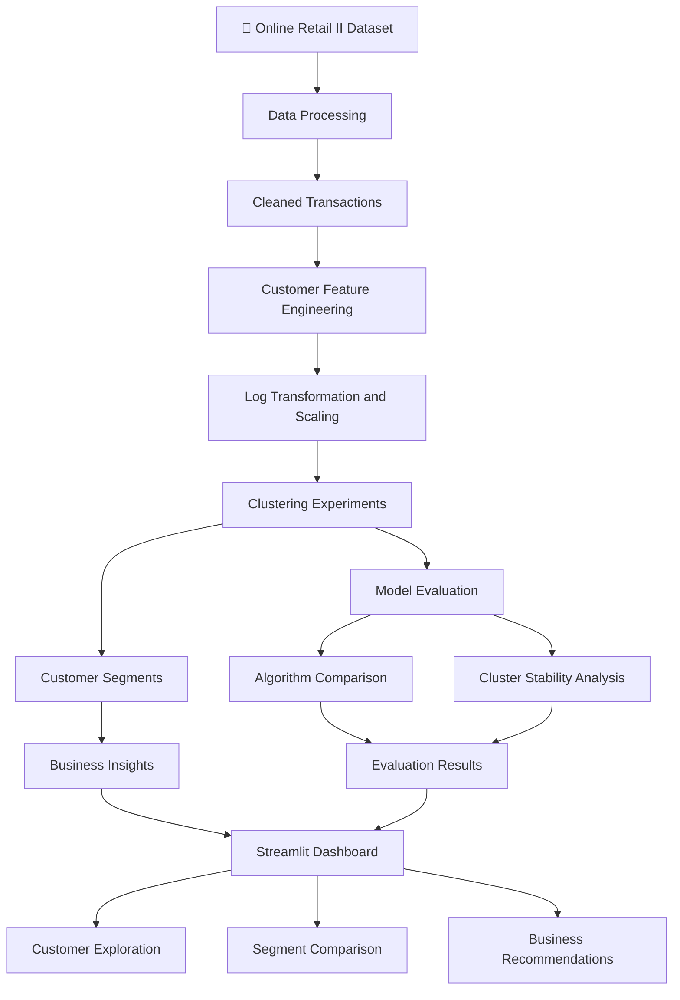
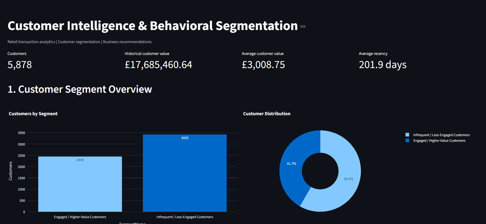
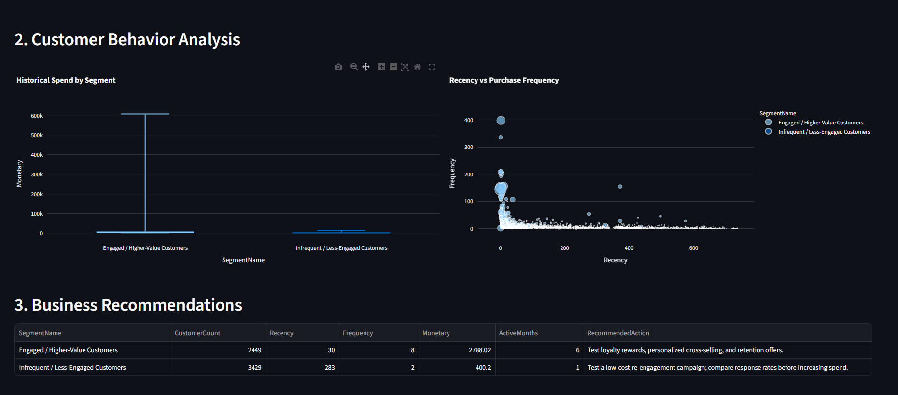
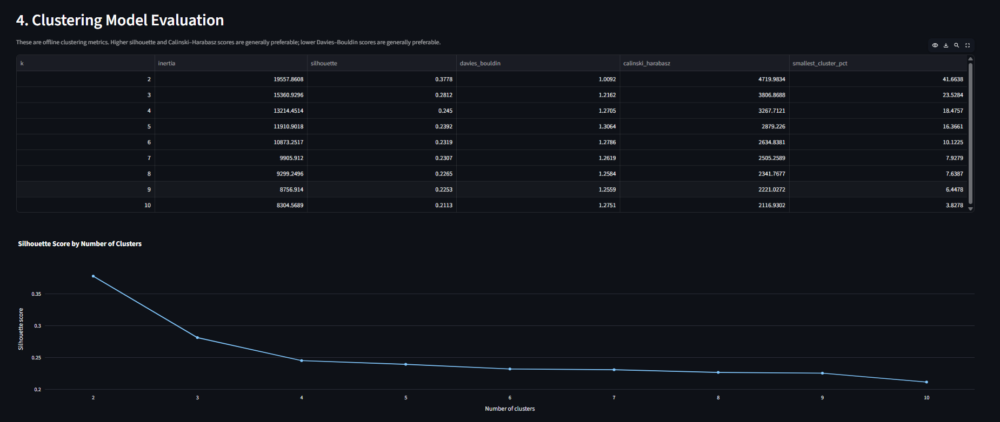

# 🧠 Customer Intelligence & Behavioral Segmentation Platform

<p align="center">
  <strong>Turning Retail Transactions into Actionable Customer Intelligence</strong>
  <br/>
  An end-to-end machine learning platform for behavioral segmentation, customer analytics, and data-driven marketing decisions.
</p>

<p align="center">
  
  
  
  
  
</p>

---

## 📌 Table of Contents

- [Project Overview](#-project-overview)
- [Business Problem](#-business-problem)
- [Project Highlights](#-project-highlights)
- [Dataset](#-dataset)
- [System Architecture](#-system-architecture)
- [Technology Stack](#-technology-stack)
- [Data Processing](#-data-processing)
- [Customer Feature Engineering](#-customer-feature-engineering)
- [Machine Learning Approach](#-machine-learning-approach)
- [Model Evaluation](#-model-evaluation)
- [Customer Segment Insights](#-customer-segment-insights)
- [Dashboard Preview](#-dashboard-preview)
- [Project Structure](#-project-structure)
- [Installation and Setup](#-installation-and-setup)
- [Running the Pipeline](#-running-the-pipeline)
- [Testing](#-testing)
- [Limitations](#-limitations)
- [Future Improvements](#-future-improvements)
- [Author](#-author)

---

## 📌 Project Overview

Retail businesses collect large volumes of transaction data, but transaction records alone do not explain how customer behavior differs across the customer base.

This project transforms historical retail transactions into customer-level behavioral profiles, applies unsupervised machine learning to identify groups of customers, and translates the resulting segments into potential business strategies.

The platform combines a reproducible data processing pipeline, customer feature engineering, clustering experiments, model validation, business insights, and an interactive Streamlit dashboard.

The objective is to demonstrate how data science can connect raw business data with interpretable customer intelligence.

## 🎯 Business Problem

Retail businesses need to answer questions such as:

- Which customers purchase frequently and spend more?
- Which customers have not purchased for a long time?
- How do purchasing frequency, spending, and product variety differ across customers?
- Which clustering approach produces useful and interpretable customer groups?
- How can customer profiles inform retention, loyalty, and re-engagement experiments?

### Proposed Solution

Build a customer intelligence platform that:

1. Cleans and validates transaction-level data.
2. Aggregates transactions into customer-level behavioral features.
3. Applies clustering algorithms to discover purchasing patterns.
4. Compares cluster quality using established internal evaluation metrics.
5. Tests the consistency of clustering results across random initializations.
6. Generates segment profiles and potential business recommendations.
7. Presents the results through an interactive analytics dashboard.

---

## 📊 Project Highlights

| Capability | Implementation |
|---|---|
| Data engineering | Multi-sheet Excel ingestion, cleaning, validation |
| Customer analytics | Six behavioral features |
| Machine learning | K-Means, Agglomerative Clustering, Gaussian Mixture Models |
| Model evaluation | Silhouette, Davies–Bouldin, Calinski–Harabasz |
| Robustness analysis | Multiple random seeds and pairwise Adjusted Rand Index |
| Business intelligence | Customer profiles and recommended actions |
| Interactive visualization | Streamlit and Plotly |
| Automated testing | Pytest test suite |
| Model persistence | Joblib |

### Project Metrics

| Metric | Result |
|---|---:|
| Raw transaction records | 1,067,371 |
| Cleaned transaction records | 793,609 |
| Records retained after cleaning | 74.35% |
| Customers analyzed | 5,878 |
| Customer behavioral features | 6 |
| Baseline clustering algorithm | K-Means |
| Baseline number of clusters | 2 |
| Baseline silhouette score | 0.3778 |
| Mean pairwise ARI across tested seeds | 0.9901 |
| Automated tests passed | 6 of 6 |

*These figures represent the current development experiment. Cluster quality is evaluated using internal metrics; business impact has not yet been established through controlled experiments.*

---

## 🗂️ Dataset

**Dataset:** Online Retail II

**Source:** UCI Machine Learning Repository

https://archive.ics.uci.edu/dataset/502/online+retail+ii

The dataset contains historical online retail transactions from two periods:

- December 2009 – December 2010
- December 2010 – December 2011

The pipeline combines both Excel sheets before cleaning and feature engineering.

### Important Dataset Characteristics

- Transaction-level records
- Customer identifiers
- Invoice identifiers and transaction dates
- Product codes and quantities
- Unit prices
- Historical purchasing behavior

### Dataset Access

The original dataset is not included in this repository.

Download it from the UCI source and place the Excel file at:

`data/raw/online_retail_II.xlsx`

The raw data is excluded from Git to avoid committing a large dataset.

---

## 🏗️ System Architecture



### Pipeline Workflow

| Stage | Description | Output |
|---|---|---|
| 1. Ingestion | Load and combine Excel sheets | Combined transaction data |
| 2. Cleaning | Remove invalid records and duplicates | `cleaned_transactions.csv` |
| 3. Feature engineering | Aggregate transaction history by customer | `customer_features.csv` |
| 4. Preprocessing | Apply log transformation and scaling | Model-ready features |
| 5. Clustering | Train K-Means across different cluster counts | Customer assignments and metrics |
| 6. Model comparison | Compare clustering algorithms | `algorithm_comparison.csv` |
| 7. Stability analysis | Compare cluster assignments across seeds | `cluster_stability.csv` |
| 8. Business insights | Generate segment profiles and proposed actions | `business_segment_profiles.csv` |
| 9. Visualization | Explore results interactively | Streamlit dashboard |

---

## 🛠️ Technology Stack

| Category | Tools |
|---|---|
| Programming language | Python |
| Data processing | Pandas, NumPy |
| Machine learning | Scikit-learn, SciPy |
| Visualization | Matplotlib, Seaborn, Plotly |
| Dashboard | Streamlit |
| Model persistence | Joblib |
| Testing | Pytest |
| Development environment | VS Code, Jupyter Notebook |
| Version control | Git and GitHub |

---

## 🧹 Data Processing

The data processing pipeline performs the following operations:

1. Loads both sheets from the source Excel workbook.
2. Combines the transaction records into one dataset.
3. Standardizes column names.
4. Parses dates and converts numerical columns to appropriate types.
5. Calculates transaction revenue as quantity multiplied by unit price.
6. Removes exact duplicate rows.
7. Excludes cancellation invoices.
8. Removes records with missing customer identifiers or dates.
9. Filters non-positive quantities and unit prices.
10. Saves the cleaned dataset for downstream analysis.

### Cleaning Summary

| Metric | Count |
|---|---:|
| Combined transaction records | 1,067,371 |
| Missing customer identifiers initially | 243,007 |
| Exact duplicate rows detected | 12,133 |
| Cancellation invoice rows detected | 19,494 |
| Non-positive quantity rows detected | 22,950 |
| Non-positive unit price rows detected | 6,207 |
| Cleaned transaction records | 793,609 |
| Records removed overall | 273,762 |

*The issue counts can overlap; they should not be summed to calculate the number of removed rows.*

The cleaning pipeline produces the transaction dataset used for customer-level aggregation.

---

## 🧩 Customer Feature Engineering

The project converts transaction-level records into a customer-level feature table.

Each customer is represented using six behavioral features.

| Feature | Definition | Interpretation |
|---|---|---|
| **Recency** | Days since the customer's last purchase relative to the dataset's final transaction date, plus one | Lower values indicate more recent purchases |
| **Frequency** | Number of distinct invoices | Measures repeat purchasing |
| **Monetary** | Sum of transaction revenue | Measures historical spending |
| **Unique Products** | Number of distinct product codes purchased | Measures product variety |
| **Average Order Value** | Monetary divided by frequency | Measures average revenue per invoice |
| **Active Months** | Number of distinct calendar months with purchases | Measures activity across time |

### Feature Engineering Results

| Feature | Mean | Median |
|---|---:|---:|
| Frequency | 6.29 | 3 |
| Monetary | 3,008.75 | 887.39 |
| Unique Products | 81.99 | 45 |
| Recency | 201.87 days | 96 days |
| Average Order Value | 389.99 | 283.61 |
| Active Months | 4.35 | 3 |

The final customer feature table contains **5,878 customers and six behavioral features**, in addition to the customer identifier.

### Preprocessing

The clustering pipeline applies:

- `numpy.log1p()` to reduce positive skew in customer-level features.
- `StandardScaler` to standardize feature scales.
- K-Means clustering with multiple values of `k`.

The fitted scaler and clustering model are saved for later inference.

---

## 🤖 Machine Learning Approach

The project uses unsupervised learning because the dataset does not provide predefined customer segment labels.

### 1. K-Means Clustering

K-Means is trained for cluster counts from \(k=2\) through \(k=10\).

The experiments use:

- Fixed random state for reproducibility
- Multiple initializations with `n_init=20`
- Maximum 500 iterations
- Silhouette score
- Davies–Bouldin index
- Calinski–Harabasz score
- Smallest-cluster percentage

### 2. Algorithm Comparison

Three clustering algorithms are evaluated:

- K-Means
- Agglomerative Clustering
- Gaussian Mixture Models

The comparison uses the same transformed and scaled customer features.

### 3. Cluster Stability

K-Means is repeated across ten random seeds for \(k=2\), \(k=3\), and \(k=4\).

Pairwise Adjusted Rand Index (ARI) is used to measure agreement between cluster assignments from different runs.

High ARI values indicate that the assignments are consistent across the tested initializations. This does not establish generalization to unseen data.

---

## 📈 Model Evaluation

### Algorithm Comparison Results

| Algorithm | Clusters | Silhouette ↑ | Davies–Bouldin ↓ | Smallest Cluster |
|---|---:|---:|---:|---:|
| **K-Means** | **2** | **0.3778** | **1.0092** | 41.66% |
| Agglomerative | 2 | 0.3593 | 1.0410 | 37.82% |
| Gaussian Mixture | 2 | 0.3363 | 1.1104 | 45.51% |
| K-Means | 3 | 0.2812 | 1.2162 | 23.53% |
| Agglomerative | 3 | 0.2095 | 1.5862 | 29.24% |
| Gaussian Mixture | 3 | 0.2048 | 1.5225 | 25.94% |
| K-Means | 4 | 0.2450 | 1.2705 | 18.48% |
| Agglomerative | 4 | 0.1770 | 1.5690 | 9.70% |
| Gaussian Mixture | 4 | 0.1321 | 3.4435 | 2.06% |

*Higher silhouette and Calinski–Harabasz scores are generally preferable; lower Davies–Bouldin scores are generally preferable. These metrics do not independently determine commercial usefulness.*

### Baseline Selection

The current baseline uses **K-Means with two clusters**, which achieved the best silhouette score among the tested algorithm and cluster-count combinations.

The result is a baseline rather than a definitive business optimum. A larger number of segments may provide more useful customer differentiation, even if its silhouette score is lower.

### Cluster Stability Results

| Clusters | Runs | Mean Silhouette | Mean Pairwise ARI | Minimum Pairwise ARI |
|---|---:|---:|---:|---:|
| 2 | 10 | 0.3779 | 0.9901 | 0.9783 |
| 3 | 10 | 0.2812 | 0.9998 | 0.9994 |
| 4 | 10 | 0.2450 | 0.9951 | 0.9867 |

The results suggest strong consistency across random initializations for the tested settings.

However, initialization stability should not be confused with temporal stability, predictive accuracy, or performance on unseen customers.

---

## 👥 Customer Segment Insights

The baseline model produces two broad customer groups. Cluster identifiers are arbitrary; the business labels are assigned after examining the segment profiles.

### Segment 1 — Engaged / Higher-Value Customers

| Indicator | Result |
|---|---:|
| Customers | 2,449 |
| Customer share | 41.66% |
| Median recency | 30 days |
| Median frequency | 8 invoices |
| Median monetary value | 2,788.02 |
| Median unique products | 115 |
| Median active months | 6 |

**Behavioral interpretation**

This group has more recent purchasing activity, higher repeat-purchase frequency, greater historical spending, and broader product variety than the second group.

**Potential business actions**

- Test loyalty rewards for repeat customers.
- Explore relevant complementary-product recommendations.
- Evaluate retention campaigns and personalized offers.
- Compare campaign response against a suitable control group.

### Segment 2 — Infrequent / Less-Engaged Customers

| Indicator | Result |
|---|---:|
| Customers | 3,429 |
| Customer share | 58.34% |
| Median recency | 283 days |
| Median frequency | 2 invoices |
| Median monetary value | 400.20 |
| Median unique products | 23 |
| Median active months | 1 |

**Behavioral interpretation**

This group has lower purchasing frequency, lower historical spending, and a longer time since the last recorded purchase.

**Potential business actions**

- Test low-cost re-engagement campaigns.
- Evaluate targeted product recommendations.
- Compare response rates before increasing marketing expenditure.
- Investigate whether the group contains multiple distinct behavioral subgroups.

*Monetary values are in the dataset's currency, GBP. The recommendations are hypotheses for testing, not evidence of causal business impact.*

---

## 📸 Dashboard Preview

The Streamlit dashboard allows users to explore customer segments, purchasing behavior, and clustering evaluation results.

### 1. Customer Intelligence Overview

The main dashboard displays the customer base, historical customer value, average customer value, average recency, and segment distribution.



### 2. Customer Behavior Analysis

Explore historical spending patterns and the relationship between recency and purchase frequency.



### 3. Business Recommendations

Review segment-level profiles and potential loyalty, retention, and re-engagement actions.


### 4. Clustering Model Evaluation

Inspect clustering metrics across different cluster counts.



### 5. Algorithm Comparison and Robustness

Compare K-Means, Agglomerative Clustering, and Gaussian Mixture Models, and review stability results across random initializations.


**Screenshot setup:** Save your actual dashboard screenshots in `reports/figures/` using the filenames referenced above. The images will appear in the GitHub README once those files are committed. You can use separate screenshots for business recommendations and model robustness if you capture them individually.

---

## 📂 Project Structure

```text
customer-intelligence-segmentation-platform/
│
├── data/
│   ├── raw/                         # Source dataset (not committed)
│   └── processed/                   # Generated data and metrics (not committed)
│
├── models/                          # Saved model artifacts (not committed)
│
├── notebooks/
│   └── 01_eda.ipynb                 # Exploratory data analysis
│
├── reports/
│   └── figures/                     # README and dashboard screenshots
│
├── src/
│   ├── __init__.py
│   ├── data_processing.py
│   ├── feature_engineering.py
│   ├── clustering.py
│   ├── business_insights.py
│   ├── segmentation_experiment.py
│   ├── algorithm_comparison.py
│   └── cluster_stability.py
│
├── tests/
│   └── test_pipeline.py
│
├── app.py                           # Streamlit dashboard
├── requirements.txt
├── .gitignore
└── README.md
```

---

## 🚀 Installation and Setup

### Prerequisites

- Python 3.10 or a compatible version
- Git
- The Online Retail II Excel dataset
- VS Code or another Python development environment

### Step 1 — Clone the Repository

```bash
git clone https://github.com/dipankar-datasci/customer-intelligence-segmentation-platform.git
cd customer-intelligence-segmentation-platform
```

### Step 2 — Create a Virtual Environment

On Windows PowerShell:

```powershell
python -m venv .venv
.\.venv\Scripts\Activate.ps1
```

### Step 3 — Install Dependencies

```powershell
python -m pip install -r requirements.txt
```

### Step 4 — Download the Dataset

Download the Online Retail II dataset from:

https://archive.ics.uci.edu/dataset/502/online+retail+ii

Place the Excel workbook at:

`data/raw/online_retail_II.xlsx`

The source dataset is not stored in the repository.

---

## ▶️ Running the Pipeline

Run the following commands from the project root, in order.

### 1. Data Processing

```powershell
python -m src.data_processing
```

Generates:

`data/processed/cleaned_transactions.csv`

### 2. Customer Feature Engineering

```powershell
python -m src.feature_engineering
```

Generates:

`data/processed/customer_features.csv`

### 3. Clustering

```powershell
python -m src.clustering
```

Generates customer segments, cluster metrics, cluster profiles, and the saved model artifact.

### 4. Business Insights

```powershell
python -m src.business_insights
```

Generates business segment profiles and updates customer segment labels and recommendations.

### 5. Algorithm Comparison

```powershell
python -m src.algorithm_comparison
```

Generates:

`data/processed/algorithm_comparison.csv`

### 6. Cluster Stability

```powershell
python -m src.cluster_stability
```

Generates:

`data/processed/cluster_stability.csv`

### 7. Run the Dashboard

```powershell
streamlit run app.py
```

Open the local URL printed in the terminal, usually:

`http://localhost:8501`

Generate the required pipeline outputs before launching the dashboard.

---

## 🧪 Testing

The project includes six automated tests.

Run them using:

```powershell
python -m pytest tests/ -v
```

The current development run passed all six tests.

The tests cover:

- Validity of cleaned transactions
- Validity of customer-level features
- Customer coverage and uniqueness in segmentation
- Availability of business segment labels and recommendations
- Validity of clustering metrics
- Loading the saved model and generating predictions

Passing these tests provides evidence of pipeline correctness for the tested cases. It does not prove business effectiveness or generalization to future data.

---

## ⚠️ Limitations

- **Historical dataset:** Recency is calculated relative to the dataset's last transaction date, not the current date.
- **Internal evaluation:** Clustering metrics measure structural separation, not business success.
- **No causal validation:** Recommended campaigns have not been shown to increase revenue or retention.
- **Initialization stability only:** ARI measures agreement across the tested random seeds, not future performance.
- **Baseline segmentation:** Two clusters provide a useful starting point, but a different cluster count may be more actionable.
- **Skewed spending distribution:** Extreme monetary values can make some visualizations difficult to interpret; log-scale or percentile-based views may help.
- **Historical purchasing patterns:** Changes in customer behavior over time require separate temporal evaluation.

---

## 🔮 Future Improvements

- [ ] Add dashboard screenshots and a polished visual presentation.
- [ ] Improve monetary-value visualizations for highly skewed data.
- [ ] Compare additional feature sets and business-oriented cluster counts.
- [ ] Evaluate segment stability over time.
- [ ] Add customer-level segment explanations.
- [ ] Build a controlled campaign evaluation framework.
- [ ] Add automated testing through GitHub Actions.
- [ ] Introduce reproducible experiment configurations and model versioning.
- [ ] Deploy the dashboard to a publicly accessible environment.

---

## 📚 References

- **Dataset:** [UCI Online Retail II](https://archive.ics.uci.edu/dataset/502/online+retail+ii)
- **Machine learning:** [Scikit-learn Clustering Documentation](https://scikit-learn.org/stable/modules/clustering.html)
- **Interactive dashboard:** [Streamlit Documentation](https://docs.streamlit.io/)
- **Testing:** [Pytest Documentation](https://docs.pytest.org/)

---

## 👨‍💻 Author

**Dipankar Sahu**

M.Sc. Data Science | Machine Learning | Customer Analytics | Data Science Engineering

GitHub: [@dipankar-datasci](https://github.com/dipankar-datasci)

Project Repository: [Customer Intelligence & Behavioral Segmentation Platform](https://github.com/dipankar-datasci/customer-intelligence-segmentation-platform)

---

<p align="center">
  <strong>From transaction data to actionable customer intelligence.</strong>
</p>